<picture>
  <source media="(prefers-color-scheme: dark)" srcset="assets/header-dark.png">
  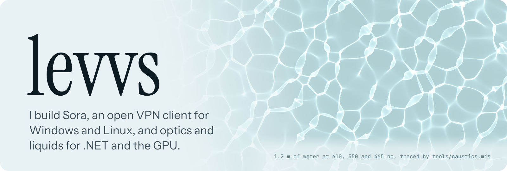
</picture>

 

<a href="https://github.com/levvs-one/sora">
  <picture>
    <source media="(prefers-color-scheme: dark)" srcset="assets/sora-dark.svg">
    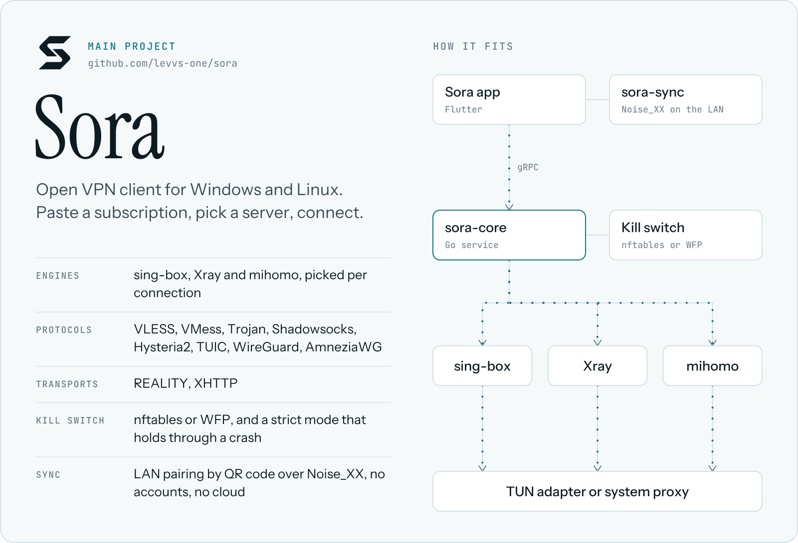
  </picture>
</a>

<a href="https://github.com/levvs-one/sora/releases/latest">
  <picture>
    <source media="(prefers-color-scheme: dark)" srcset="assets/sora-screen-dark.png">
    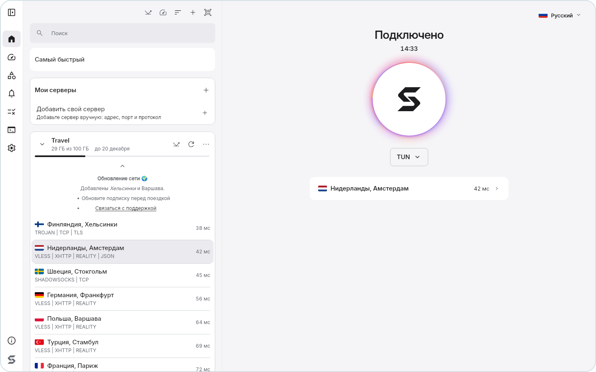
  </picture>
</a>

  <a href="https://github.com/levvs-one/sora/releases/latest"><b>Download Sora</b></a>&emsp;&emsp;
  <a href="https://github.com/levvs-one/sora/blob/main/docs/architecture.md">Architecture</a>&emsp;&emsp;
  <a href="https://github.com/levvs-one/sora/blob/main/docs/security.md">Threat model</a>&emsp;&emsp;
  <a href="https://t.me/sora_client">Telegram channel</a>

 

<picture>
  <source media="(prefers-color-scheme: dark)" srcset="assets/label-network-dark.svg">
  
</picture>

  <a href="https://github.com/levvs-one/traverce"><picture><source media="(prefers-color-scheme: dark)" srcset="assets/card-traverce-dark.svg">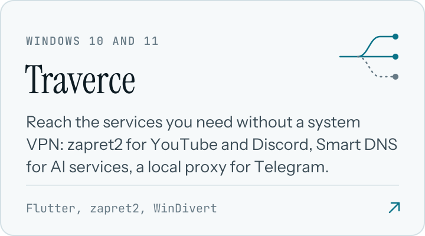</picture></a>
  <a href="https://github.com/levvs-one/sora-legacy"><picture><source media="(prefers-color-scheme: dark)" srcset="assets/card-sora-legacy-dark.svg">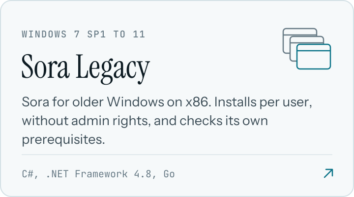</picture></a>

<picture>
  <source media="(prefers-color-scheme: dark)" srcset="assets/label-light-dark.svg">
  
</picture>

  <a href="https://caustikon.levvs.cc"><picture><source media="(prefers-color-scheme: dark)" srcset="assets/card-caustikon-dark.svg">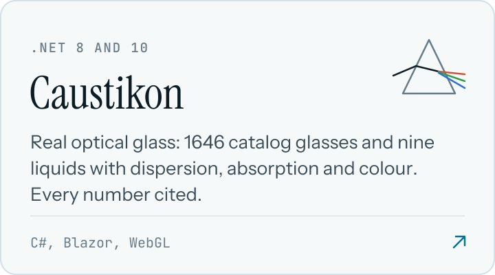</picture></a>
  <a href="https://undine.levvs.cc"><picture><source media="(prefers-color-scheme: dark)" srcset="assets/card-undine-dark.svg">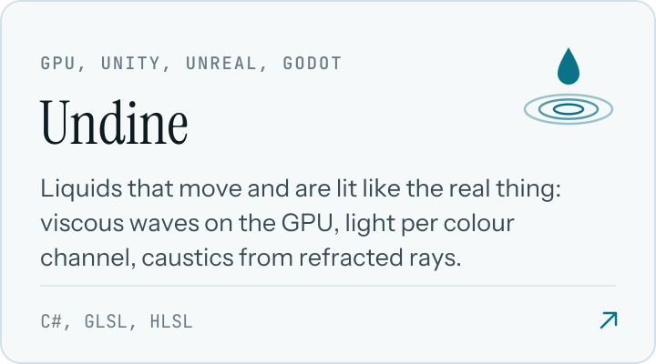</picture></a>

  Both run in the browser: <a href="https://caustikon.levvs.cc">caustikon.levvs.cc</a> and <a href="https://undine.levvs.cc">undine.levvs.cc</a>. Source: <a href="https://github.com/levvs-one/caustikon">caustikon</a>, <a href="https://github.com/levvs-one/undine">undine</a>.

<picture>
  <source media="(prefers-color-scheme: dark)" srcset="assets/label-tools-dark.svg">
  
</picture>

  <a href="https://github.com/levvs-one/carryall"><picture><source media="(prefers-color-scheme: dark)" srcset="assets/card-carryall-dark.svg">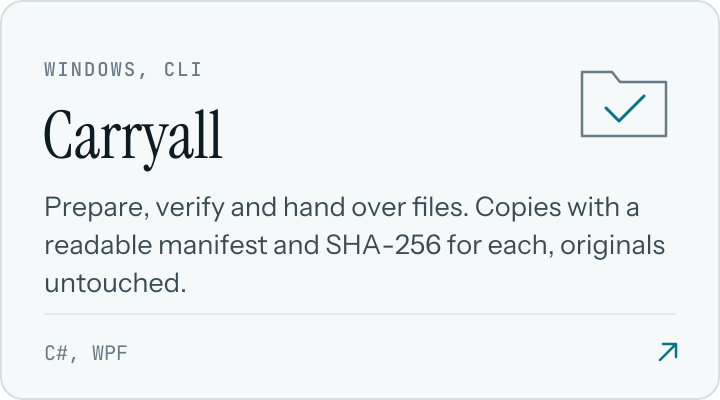</picture></a>
  <a href="https://github.com/levvs-one/diptych"><picture><source media="(prefers-color-scheme: dark)" srcset="assets/card-diptych-dark.svg">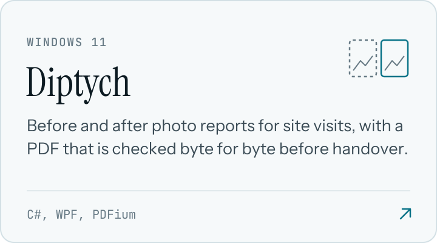</picture></a>

  <a href="https://github.com/levvs-one/humanizer"><picture><source media="(prefers-color-scheme: dark)" srcset="assets/card-humanizer-dark.svg">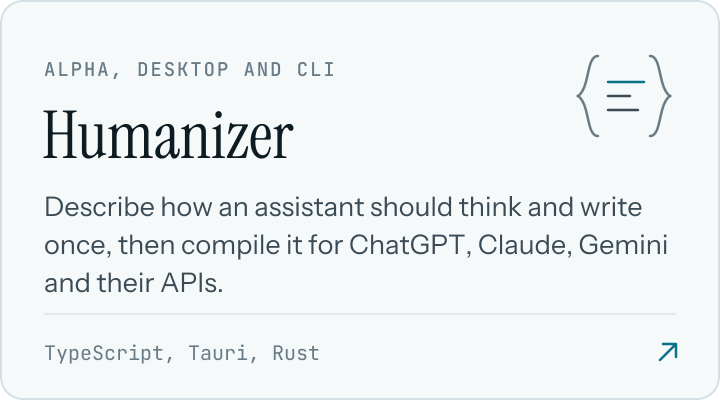</picture></a>
  <a href="https://github.com/levvs-one/llms-txt-snapshots"><picture><source media="(prefers-color-scheme: dark)" srcset="assets/card-llms-txt-snapshots-dark.svg">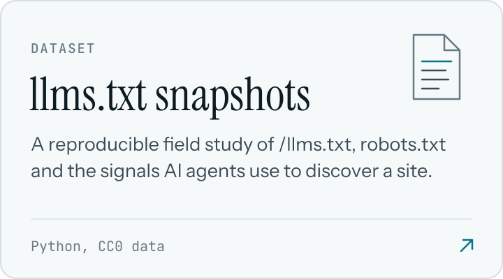</picture></a>

<picture>
  <source media="(prefers-color-scheme: dark)" srcset="assets/label-ship-dark.svg">
  
</picture>

- Release builds come with SHA-256 sums. Sora's install scripts and updater refuse a file that does not match.
- Every public repository runs CI on push and on pull requests.
- Nothing is code-signed yet, so the checksums and the build steps are the proof.
- Sora and Traverce send no telemetry. Carryall and Diptych work offline and never change your originals.
- Old systems count: Sora Legacy targets Windows 7 SP1 on x86.

 

<a href="https://t.me/levvs_one">Telegram</a>

Every image here is built by <a href="tools/build.mjs"><code>tools/build.mjs</code></a>. The type is Instrument Serif, Instrument Sans and JetBrains Mono, set as outlines. The header is sunlight through 1.2 m of rippled water, traced per colour channel.
